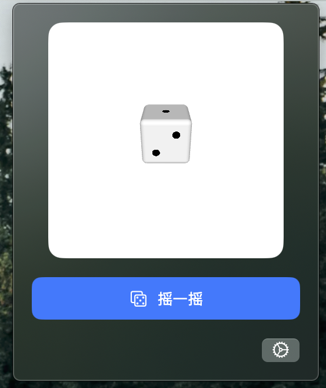
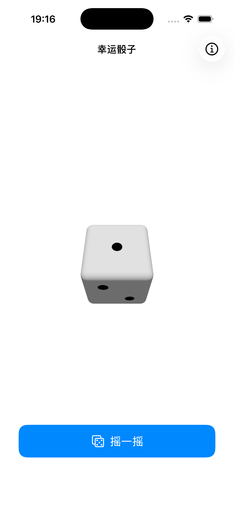

# 幸运骰子


一个简洁的 3D 骰子应用，支持 macOS 状态栏和 iOS 设备。

## 下载安装

### macOS

[下载最新版本](https://github.com/Hao-yiwen/dice/releases/) — DMG 已通过 Apple Developer ID 签名和公证，下载后直接使用。

### iOS

[App Store 下载](https://apps.apple.com/cn/app/id6759647033)

## 功能特点

- 精美 3D 骰子渲染
- 点击按钮或摇一摇掷骰子
- iOS 小组件支持，一键直达
- 完全离线，无广告，不收集任何数据
- 支持中英文

## 系统要求

- **运行**：macOS 14.0 或更高版本；iOS 17.0 或更高版本
- **开发构建**：**Xcode 16.0+**（需含 iOS 17 / macOS 14 SDK；未使用 Xcode 27 独占特性，更高版本稳定版亦可），Swift 5 语言模式（`SWIFT_VERSION = 5.0`），工程级 `SWIFT_STRICT_CONCURRENCY = minimal`
- **依赖**：无 CocoaPods / SPM 第三方依赖，仅使用系统框架（SwiftUI、SceneKit、WidgetKit、StoreKit 等）

## 从源码运行（开发）

1. 克隆仓库：

   ```bash
   git clone https://github.com/Hao-yiwen/dice.git
   cd dice
   ```

2. 用 Xcode 打开工程：

   ```bash
   open dice.xcodeproj
   ```

3. 在 Xcode 中选择 Scheme：
   - **dice**：macOS 菜单栏应用
   - **dice_ios**：iOS 应用（会嵌入 `dice_ios_widgetExtension` 小组件）

4. 选择目标设备或模拟器 / Mac，点击 Run（⌘R）。

5. （可选）若需本地签名，在 Signing & Capabilities 中选择自己的 Development Team；仓库默认 Team 为原作者配置，克隆后可能需改为本机账号。

6. iOS 小组件通过 `diceapp://roll` 深链打开主应用并触发掷骰；URL Scheme 已在 `dice_ios/Info.plist` 中声明。

### 静态检查（无需 Xcode）

```bash
./scripts/verify-project.sh
```

该脚本会检查部署目标、Info.plist 深链、Scheme 启动配置、常见废弃 API/脆弱实现；若存在 Swift 开源工具链（默认 `.swift-toolchain/`），还会对所有 `.swift` 做 `swift frontend -parse` 语法检查（不链接 Apple SDK，不能替代 `xcodebuild`）。

### 命令行构建（需在 macOS + Xcode 环境）

```bash
# macOS
xcodebuild -project dice.xcodeproj -scheme dice -configuration Debug \
  -destination 'platform=macOS' build

# iOS 模拟器
xcodebuild -project dice.xcodeproj -scheme dice_ios -configuration Debug \
  -destination 'generic/platform=iOS Simulator' build
```

发布用 macOS DMG（签名与公证）可参考 `scripts/build-macos-dmg.sh`。

## 安装说明（发行版）

### macOS

1. 下载 DiceGenerator.dmg
2. 打开 DMG 文件
3. 将应用拖入 Applications 文件夹

### iOS

1. 从 App Store 下载安装
2. 或按上方「从源码运行」用 Xcode 构建

## 预览





## 支持我的工作

如果这个项目对你有帮助，可以请我喝杯咖啡 ☕️

<details>
<summary>
  
</summary>
<br>

</details>
